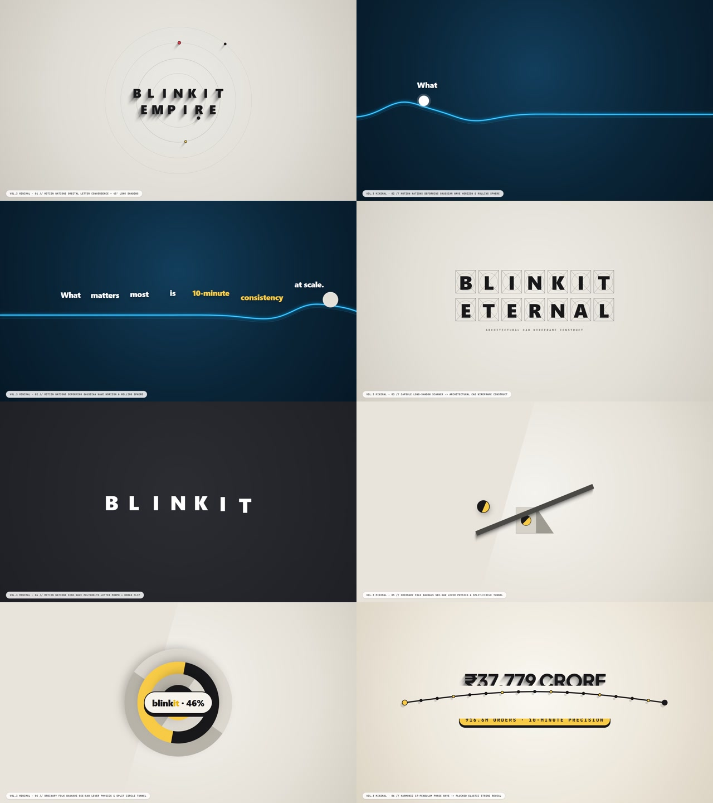
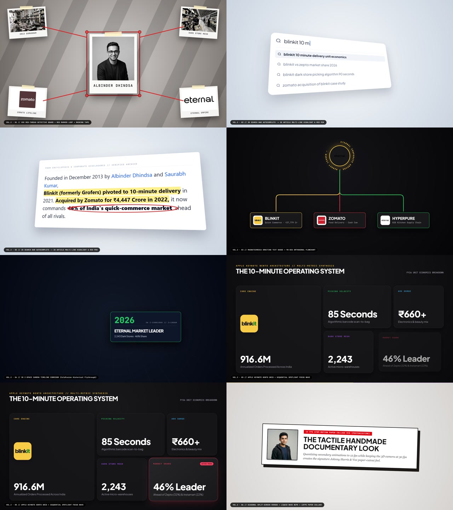
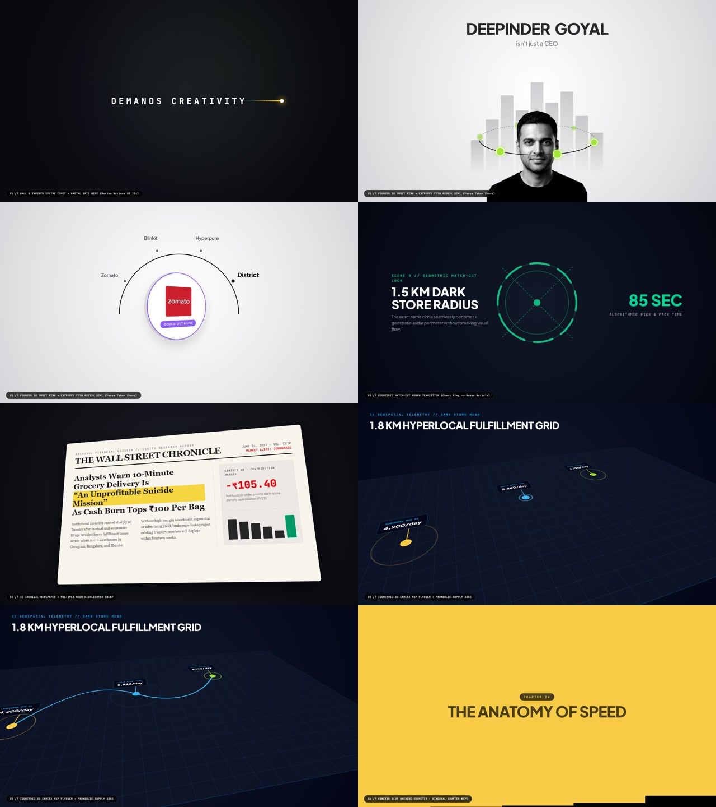

# Mathematical Motion-Graphics Documentary & Transitions Studio (Node 2 Agent Kit)





A deterministic, pure-math **After Effects-grade Documentary & Motion-Graphics Engine** built for **Node 2 Agent (Google AI Studio Gemini)** and autonomous documentary production pipelines.

Every frame is a closed-form mathematical function of time $\text{Frame}(t) = f(t)$ — zero CSS transitions, zero `requestAnimationFrame` state drift, Newton-Raphson cubic-bezier inversion, second-order damped harmonic oscillator ODEs, 2D arc-length Catmull-Rom/Bezier splines, 5-plane 3D multiplane parallax camera rigs, 4-tier 3D isometric exploded CAD stacks, real-time 3D orthographic spherical projection globes, 12fps `posterizeTime` paper stop-motion, and multi-worker headless Playwright 1080p30 MP4 rendering.

---

## Quick Navigation for Node 2 Agent (Google AI Studio)

| Resource | Path | Purpose |
| :--- | :--- | :--- |
| **Google AI Studio System Prompt** | [`GOOGLE_AI_STUDIO_SYSTEM_PROMPT.md`](./GOOGLE_AI_STUDIO_SYSTEM_PROMPT.md) | Copy-paste directly into Google AI Studio System Instructions for generating complete documentaries + **"What to Show When"** Decision Matrix. |
| **End-to-End Skill Specification** | [`.agents/skills/math-motion-documentary/SKILL.md`](./.agents/skills/math-motion-documentary/SKILL.md) | Master skill manual covering research, scripting, word-level TTS sync, math, 19 pre-made rigs, non-black studio palettes, and MP4 rendering. |
| **Transitions & "What to Show When" Guide** | [`TUTORIAL_AND_TRANSITIONS_GUIDE.md`](./TUTORIAL_AND_TRANSITIONS_GUIDE.md) | Mathematical breakdown, code architecture, and narrative choreography guide for all **19 pre-made transition & motion rigs**. |
| **Pre-Made Transitions — Vol. 3 Minimalist + Heavy Physics (6 Rigs, Zero Black BG)** | [`src/components/blinkit/FeaturedTransitionsVol3Heavy.tsx`](./src/components/blinkit/FeaturedTransitionsVol3Heavy.tsx) | Motion Nations Orbital Letter Convergence + 45° Long Shadows, Deforming Gaussian Wave Horizon + Rolling Sphere, Capsule Long-Shadow Scanner + CAD Wireframe Construct, Sine-Wave Polygon-to-Letter Morph, Ordinary Folk Bauhaus See-Saw Lever + Split-Circle Tunnel, and 17-Pendulum Phase Wave -> Plucked Elastic String (`/?showcase=3`). |
| **Pre-Made Transitions — Vol. 2 (6 Rigs)** | [`src/components/blinkit/FeaturedTransitionsVol2.tsx`](./src/components/blinkit/FeaturedTransitionsVol2.tsx) | Vox Red-Thread Detective Corkboard, 3D Search-to-Article Flip, MagnatesMedia Circular Text Badge + Orthogonal Flowchart, 3D Z-Space Corridor, Apple Bento Grid, and Diagonal Versus + Liquid Wave + 12fps Stop-Motion (`/?showcase=2`). |
| **Pre-Made Transitions — Vol. 1 (7 Rigs)** | [`src/components/blinkit/FeaturedTransitions.tsx`](./src/components/blinkit/FeaturedTransitions.tsx) | Ball-Line Spline Comets, 3D Founder Orbit Rigs, 3D Coin Flip Dials, Match-Cuts, 3D Newspapers, Isometric Maps, and Odometers (`/?showcase=1`). |
| **Pure-Math Kinematics Engine** | [`src/lib/kinematics.ts`](./src/lib/kinematics.ts) | Closed-form Spring ODE solver, Newton-Raphson `cubicBezier`, velocity derivatives, and Arc-Length Splines. |
| **Option 3 Soundtrack Synthesizer** | [`scripts/build_final_soundtrack_opt3.py`](./scripts/build_final_soundtrack_opt3.py) | 116 BPM *Vox / Johnny Harris* "Modern Ambient Momentum" score generator with -18 dB voice sidechain ducking and stereo transition whooshes. |
| **Rendered Showcase Video — Vol. 3 Heavy** | [`public/motion_transitions_vol3_heavy_showcase.mp4`](./public/motion_transitions_vol3_heavy_showcase.mp4) | 24s 1080p30 MP4 demonstrating all 6 Volume 3 Heavy rigs (Zero Black BG). |
| **Rendered Showcase Video — Vol. 2** | [`public/motion_transitions_vol2_showcase.mp4`](./public/motion_transitions_vol2_showcase.mp4) | 24s 1080p30 MP4 demonstrating all 6 Volume 2 rigs. |
| **Rendered Showcase Video — Vol. 1** | [`public/motion_transitions_showcase.mp4`](./public/motion_transitions_showcase.mp4) | 24s 1080p30 MP4 demonstrating all 7 Volume 1 rigs. |

---

## "What to Show When" — Documentary Visual Choreography Matrix

| Narrative Beat in Script | Exact Component Rig to Deploy | Reference Style |
| :--- | :--- | :--- |
| **1. Hook Paradox / Thesis Statement** | `BallSplineCometTransition` (Vol. 1) | *Motion Nations (`00:10s` Line & Ball)* |
| **2. Introducing a Founder / CEO Empire** | `FounderEmpireOrbitRig` (Vol. 1) | *Pooya Taher (3D Depth-Sorted Orbit)* |
| **3. Crisis, Scandal, or Secret Deal** | `RedThreadEvidenceBoardRig` (Vol. 2) | *AEffecto / Vox (Corkboard + Red Yarn + Dymo)* |
| **4. Proving a Fact via Search / Filing / Press** | `VoxScreenRecording3DBrowser` (Vol. 2) or `NewspaperMicrofilmHighlighter` (Vol. 1) | *Motion Nations / Vox (3D Search -> Highlighted Article)* |
| **5. Parent Company & Subsidiary Ecosystem** | `MagnatesFlowchartAndOrbitBadgeRig` (Vol. 2) or `CoinFlipRadialDialRig` (Vol. 1) | *Vane Motion / MagnatesMedia (`<textPath>` + Flowchart)* |
| **6. Multi-Year Historical Evolution** | `ThreeDCameraTimelineCorridor` (Vol. 2) | *ColdFusion (3D Z-Space Portal Flythrough)* |
| **7. Geographic Grid / Supply Chain / Dark Stores** | `Isometric3DCameraMapFlyover` (Vol. 1) | *Johnny Harris / fern (3D Tilted Map + Arcs)* |
| **8. Multi-Metric Operating System Breakdown** | `AppleBentoGridShowcaseRig` (Vol. 2) | *Apple Keynote (5-Card Bento + Spotlight Wave)* |
| **9. Head-to-Head Competitor Showdown** | `SplitScreenVersusAndCollageRig` (Vol. 2) | *Vox (Diagonal Clash -> Liquid Wave -> 12fps Collage)* |
| **10. Climax Financial / Revenue Counter** | `KineticSlotMachineOdometer` (Vol. 1) | *Rolling Digit Barrels + Shutter Slice Wipe* |

---

## Running & Rendering Locally

```bash
# 1. Install dependencies
bun install

# 2. Build production bundle
bun run build

# 3. Render Volume 1 & Volume 2 Transitions Showcases (1080p30 MP4)
python render_transitions_showcase.py
python render_transitions_vol2.py

# 4. Synthesize Option 3 Master Soundtrack & Render Full Documentary (1080p30 MP4)
python scripts/build_final_soundtrack_opt3.py
python render_blinkit_mp4.py
```
